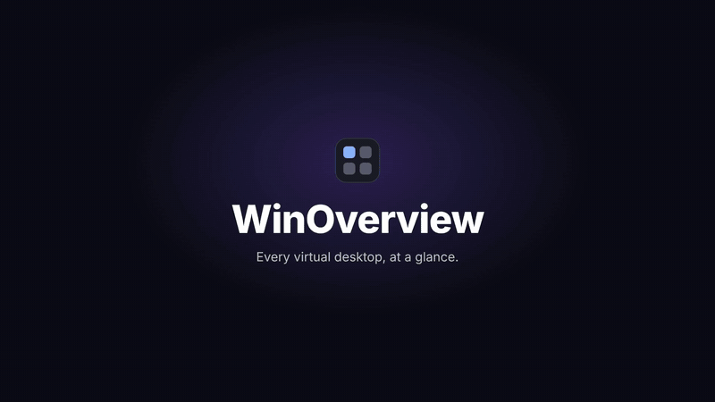

# WinOverview

A fast virtual-desktop overview for Windows 11, inspired by
[quickshell-overview](https://github.com/Shanu-Kumawat/quickshell-overview) for Hyprland.

Press **Alt + `** to see every virtual desktop and the apps on it, drag apps between desktops,
snap them into split-screen layouts, and jump anywhere with one click.

**[⬇ Download the latest release](../../releases/latest)**  ·  Windows 11  ·  Free & open source (MIT)

## Features

- **All desktops at a glance**: each desktop shows its apps as icons, with the current one highlighted
- **Two views**: app icons, or live mini-screens of every desktop
- **Live preview on hover** (icons view): rest the mouse on an app to see its window
- **Keyboard-first**: arrows, Enter, type to search, Ctrl+1–9 to move apps
- **Drag and drop**: drag an app onto another desktop (or onto **+** to make a new one) and watch it fly there
- **Snap layouts**: drop an app outside the panel to pick a layout; it splits the screen with the app you were using
- **Close apps or whole desktops**: hover for the **×** (a closed desktop's apps move to desktop 1)
- **Keeps your screen and taskbar visible** (optional blurred screen or wallpaper background)
- **Tray icon** with *Start with Windows* and *Settings*
- **Pomodoro timer and music controls** under the desktops (works with Spotify, YouTube, Media Player…)
- **Multi-monitor**: opens on the screen your mouse is on
- **Configurable**: hotkey, accent colour, position, and more in `config.json`, applied as soon as you save

## Install

1. Download **`WinOverview.exe`** from **Releases** (small, about 25–30 MB).
2. Double-click it.
   - It needs the free **.NET 10 Desktop Runtime**. If it isn't installed, Windows shows a message
     with a download link: install it once, then run WinOverview again.
     ([Direct download](https://dotnet.microsoft.com/download/dotnet/10.0): pick *.NET Desktop Runtime*, *x64*.)
3. Press **Alt + `** (the key left of 1). It lives in the tray; right-click the icon → **Start with Windows**.

Requires 64-bit Windows 11, 24H2 or newer.

> Windows may show "Windows protected your PC" the first time, because the app isn't code-signed.
> Click **More info → Run anyway**.

## Controls

| Mouse | |
|---|---|
| Click an app | Go to it |
| Drag an app onto a desktop / **+** | Move it there / to a new desktop |
| Drag an app outside the panel | Snap layouts / split screen |
| Click a desktop | Switch to it |
| **×** on an app / desktop, or middle-click | Close it |

| Keyboard | |
|---|---|
| **Alt + `** | Open / close the overview |
| **← →** / **Tab** | Select the previous / next app |
| **↑ ↓** | Row above / below, inside a desktop |
| **Enter** | Open the selected app |
| **Delete** | Close the selected app |
| **Ctrl + 1–9** | Move the selected app to that desktop |
| **1–9** | Switch to that desktop |
| Just type | Search apps by name (**Esc** clears) |
| **Esc** | Hide |

## Settings

Right-click the tray icon → **Settings…**. Every change applies right away:

- **General:** shortcut (click the box and press new keys), start with Windows, which screen to open on, auto-hidden taskbar
- **Appearance:** desktop view (**app icons** or **live previews** of each desktop), accent colour, panel position, desktops per row, background
- **Behaviour:** preview on hover (icons view) and its delay
- **Widgets:** add or remove the focus timer and music player (remove them all for a plain task view), and set the timer lengths

Settings live in `%AppData%\WinOverview\config.json` (Settings → *Open config file*).

## Uninstall

Run **`uninstall.bat`** (it's next to `WinOverview.exe` in releases, and in the project folder).
It closes WinOverview and removes its settings, helper files, *Start with Windows* entry and the
`.exe` in the same folder.

## Build from source

Needs the [.NET 10 SDK](https://dotnet.microsoft.com/download). `VirtualDesktopAccessor.dll`
(from [Ciantic/VirtualDesktopAccessor](https://github.com/Ciantic/VirtualDesktopAccessor/releases)) is already in the repo.

- **Run while developing:** double-click `start.bat` (builds only when the code changed, then starts it).
- **Make the one-file release:** double-click `publish.bat` → `dist\WinOverview.exe`.
- **Let GitHub build it:** push a tag like `v1.0.0`. The workflow in `.github/workflows/release.yml`
  builds `WinOverview.exe` and attaches it to a GitHub Release.

## How it works

| File | Job |
|---|---|
| `MainWindow.xaml(.cs)` | The overlay window: settings, open/close, animation |
| `Overlay/Tiles.cs` | Desktop tiles, app icons, the live-preview grid |
| `Overlay/Keyboard.cs` | Keyboard navigation and search |
| `Overlay/DragDrop.cs` | Dragging apps between desktops |
| `Overlay/SnapPicker.cs` | Snap layouts / split screen |
| `Overlay/WidgetTiles.cs` | Focus timer and music tiles |
| `Overlay/LivePreviews.cs` | Placing the live previews |
| `Overlay/Actions.cs` | Switching desktops, focusing and closing apps |
| `App.xaml.cs` | Startup, single instance, restart, settings reload |
| `UI/PreviewPopup.cs` | Live preview on hover (DWM thumbnails) |
| `UI/TrayIcon.cs` | Tray icon and its menu |
| `UI/AppConfig.cs` | `config.json` settings |
| `UI/SettingsWindow.cs` | The Settings window |
| `UI/ThumbnailHost.cs` | Live previews in the desktop tiles (previews view) |
| `UI/Widgets.cs` | Pomodoro timer and media (now playing) controls |
| `Core/Desktops.cs` | Virtual desktops (VirtualDesktopAccessor.dll) and the list of app windows |
| `Core/Helpers.cs` | App icons, blurred wallpaper, taskbar, monitors |
| `Core/NativeMethods.cs` | Windows API declarations |

## Credits

- Idea and design: [quickshell-overview](https://github.com/Shanu-Kumawat/quickshell-overview)
  by Shanu-Kumawat, itself from [illogical-impulse](https://github.com/end-4/dots-hyprland) by end-4.
  WinOverview is a separate from-scratch rewrite for Windows; no code is shared.
- Virtual desktop access: [VirtualDesktopAccessor](https://github.com/Ciantic/VirtualDesktopAccessor) by Ciantic (MIT).

## License

[MIT](LICENSE). Third-party parts are listed in [THIRD_PARTY_NOTICES.md](THIRD_PARTY_NOTICES.md).
WinOverview is an independent project and isn't affiliated with Microsoft.
