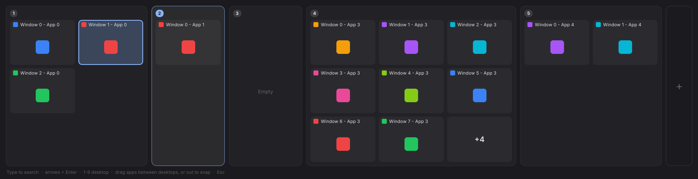
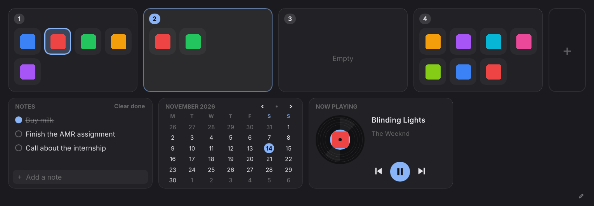
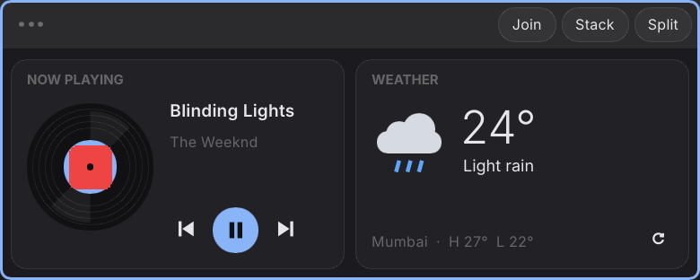
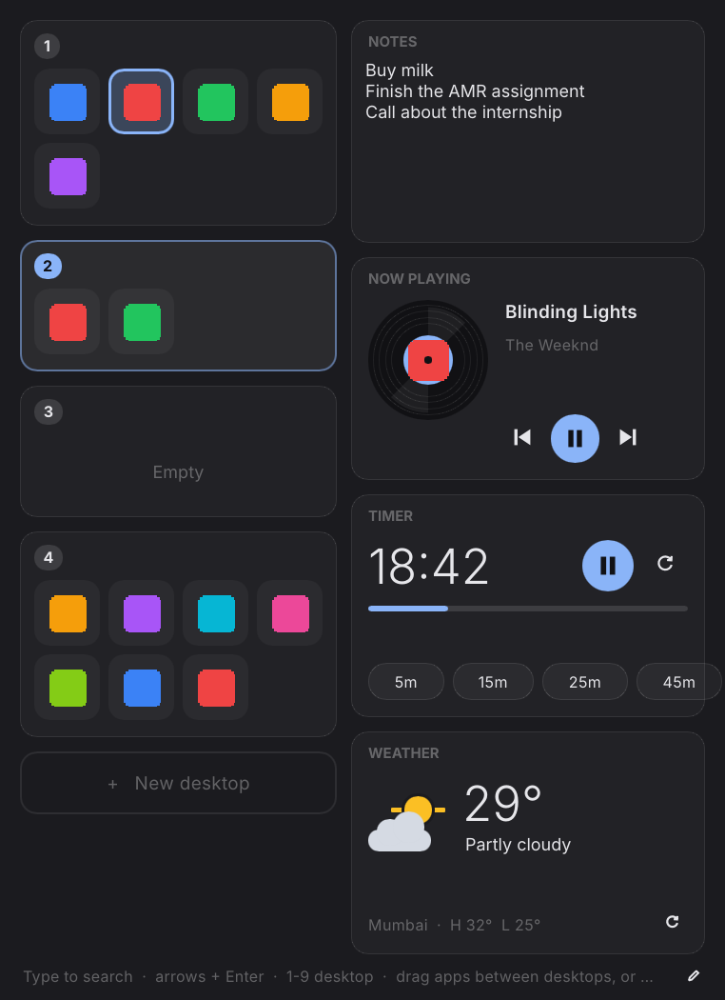
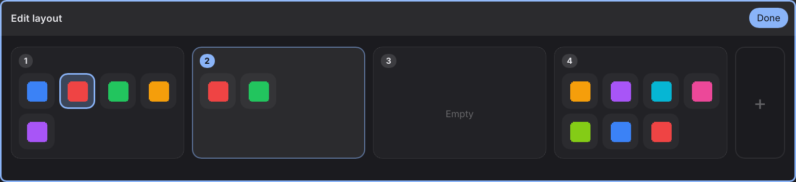

# WinOverview (Rust)

A small, minimal overview of your virtual desktops for Windows 11 — instead of the full-screen Win+Tab.
Inspired by Hyprland's quickshell-overview.


https://github.com/user-attachments/assets/cf030b0d-e69a-4de0-8b2d-efcb17a8bd39

**[⬇ Download the latest release](../../releases/latest)** · Windows 11 · Free & open source (MIT)

One small `.exe`, nothing else to install.

## Use it

Press **Alt + `** (the key above Tab).

- **Click** a desktop to go there, or an app to open it
- **Drag** an app onto another desktop, or onto **+** to make a new desktop
- **Drag a desktop** onto another one to reorder your desktops
- **×** closes an app, or a whole desktop (its apps move to desktop 1)
- **Type** to search, **arrows** to move, **Enter** to open, **Delete** to close the selected app
- **1–9** jumps to that desktop, **Esc** closes the overview
- **Drag an app out of the panel** to snap it: pick a layout, and the app you were using fills the other side


**Two views** (Settings → Show apps as):
- **Icons** — compact; hover an app to see a live preview of it
- **Live previews** — every desktop shows its windows live; tiles grow with the number of apps



**Widgets** (Settings → Widgets, or the ✎ button): pick any of
- **Notes** — a quick checklist: add items, click one to strike it through
- **Now playing** — whatever's playing (Spotify, YouTube in a browser…) on a spinning record with its album art; click it to jump to the player
- **Timer** — 5 / 15 / 25 / 45 minutes, with a sound and a message when it's done
- **Weather** — for the city you set in Settings (from open-meteo.com, no account needed)
- **Calendar** — the month at a glance, today highlighted



**Layout** — two separate settings:
- **Placement:** *Fixed* (widgets sit inside the panel) or *Free* (widgets float in capsules anywhere on screen). In edit mode, **Join** puts widgets in one capsule so they move together (**Split** separates them, **Stack** turns them)
- **Arrangement:** *Row* (desktops side by side) or *Column* (desktops stacked) — works with either placement



**Widget size:** Small, Medium or Large (Settings), the same for every widget.



**Put it anywhere:** click ✎ (bottom-right of the panel) or *Edit layout…* in the tray menu, drag the panel (and, in Free layout, each widget) where you want it, then *Done*. It opens there from then on.

**Privacy mode:** right-click an app in the overview (or pick apps in Settings → Privacy) and it shows only its icon: no live preview, no hover preview, no window title.



**Themes:** Midnight, AMOLED, Nord, Mocha, Rosé Pine, Forest and Light, plus an accent colour.

Right-click the tray icon for **Settings**, **Start with Windows**, Restart and Quit.

Windows SmartScreen may warn you the first time because the app isn't signed: **More info → Run anyway**.

## Build it yourself

Needs [Rust](https://rustup.rs) and the *Desktop development with C++* part of Visual Studio Build Tools.

```
build.bat
```

The exe ends up in `dist\WinOverview.exe`. `run.bat` builds and starts it in one go.

## Uninstall

Run `uninstall.bat` (it's next to the exe in every release). It removes the settings, the "Start with Windows" entry and the exe.

## Credits

[](https://slint.dev)

- UI: [Slint](https://slint.dev) (Royalty-free license)
- Virtual desktops: [winvd](https://github.com/Ciantic/VirtualDesktopAccessor) by Jari Pennanen (MIT), with Windows 11 22H2/23H2 support added by [Dxian998](https://github.com/Dxian998)
- Weather data: [Open-Meteo](https://open-meteo.com) (CC BY 4.0)
- Built with help from Claude (Anthropic)

See [THIRD_PARTY_NOTICES.md](THIRD_PARTY_NOTICES.md).

## License

MIT — see [LICENSE](LICENSE).
