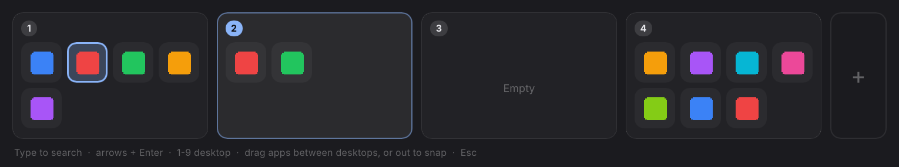
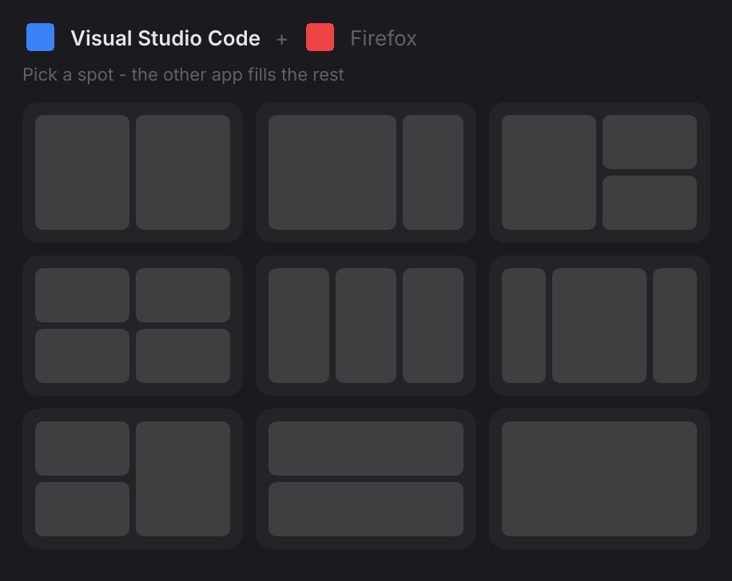

# WinOverview (Rust)

A small, minimal overview of your virtual desktops for Windows 11 — instead of the full-screen Win+Tab.
Inspired by Hyprland's quickshell-overview.



**[⬇ Download the latest release](../../releases/latest)** · Windows 11 · Free & open source (MIT)

One small `.exe`, nothing else to install.

## Use it

Press **Alt + `** (the key above Tab).

- **Click** a desktop to go there, or an app to open it
- **Drag** an app onto another desktop, or onto **+** to make a new desktop
- **×** closes an app, or a whole desktop (its apps move to desktop 1)
- **Type** to search, **arrows** to move, **Enter** to open, **Delete** to close the selected app
- **1–9** jumps to that desktop, **Esc** closes the overview
- **Drag an app out of the panel** to snap it: pick a layout, and the app you were using fills the other side



**Two views** (Settings → Show apps as):
- **Icons** — compact; hover an app to see a live preview of it
- **Live previews** — every desktop shows its windows live; tiles grow with the number of apps


**Themes:** Midnight, AMOLED, Nord, Mocha, Rosé Pine, Forest and Light, plus an accent colour.

Right-click the tray icon for **Settings**, **Start with Windows**, Restart and Quit.

Windows SmartScreen may warn you the first time because the app isn't signed: **More info → Run anyway**.

## Build it yourself

Needs [Rust](https://rustup.rs) and the *Desktop development with C++* part of Visual Studio Build Tools.

```
build.bat
```

The exe ends up in `dist\WinOverview.exe`. `run.bat` builds and starts it in one go.

## Uninstall

Run `uninstall.bat` (it's next to the exe in every release). It removes the settings, the "Start with Windows" entry and the exe.

## Credits

[](https://slint.dev)

- UI: [Slint](https://slint.dev) (Royalty-free license)
- Virtual desktops: [winvd](https://github.com/Ciantic/VirtualDesktopAccessor) by Jari Pennanen (MIT)
- Built with help from Claude (Anthropic)

See [THIRD_PARTY_NOTICES.md](THIRD_PARTY_NOTICES.md).

## License

MIT — see [LICENSE](LICENSE).
